# Estudo de seleção de melhores momentos

## Eventos, cortes e detecções de jogadores

Estudo exploratório para pré-seleção de melhores momentos e redução do contexto enviado a uma LLM.

Fotografia: 2026-10-09T15:58:11. Foram lidos 63 arquivos completos. A análise principal usa 43 tempos únicos de 22 partidas, com 4675 eventos e 33.10 horas cobertas pelo YOLO.

Hipótese: a edição televisiva após certos eventos apresenta mais mudanças de cena, planos curtos e poucas detecções de jogadores. A hipótese é testada; nenhuma correlação é presumida.

As anotações servem para medir os resultados. O filtro de produção utiliza somente cenas do TransNetV2 e contagens do YOLO. Não há chamada a LLM nem gasto de API neste estudo.

## Método e unidade de análise

Arquivos da mesma competição, temporada, partida e tempo são duplicatas de conteúdo. Foi mantida a maior resolução disponível em cada grupo. Os tempos de uma mesma partida permanecem no mesmo conjunto de avaliação.

A contagem de cortes considera os inícios de cena, excluindo t=0. Uma cena curta tem duração de até 8 s na análise descritiva. Cena curta com baixa detecção exige pelo menos três amostras YOLO e zero jogadores em pelo menos 80% delas.

Para cada evento com 30 s disponíveis de ambos os lados, comparamos [-30,0) e [0,30) s. Os controles são janelas de 30 s na mesma transmissão, com centro afastado mais de 60 s de qualquer anotação. Controles não garantem ausência de acontecimentos não anotados.

Cada partida recebe o mesmo peso nos contrastes: primeiro agregamos eventos por vídeo e tempos por partida. Os intervalos de 95% vêm de 2.000 reamostragens de partidas, semente 42. Eles expressam a incerteza deste recorte e não corrigem todas as comparações exploratórias.

Janelas de eventos podem sobrepor-se; frames e eventos não são observações independentes. A série temporal é descritiva. Associação com a edição não implica causalidade nem identifica por si só o tipo de jogada.

## Amostra e divisão por partida

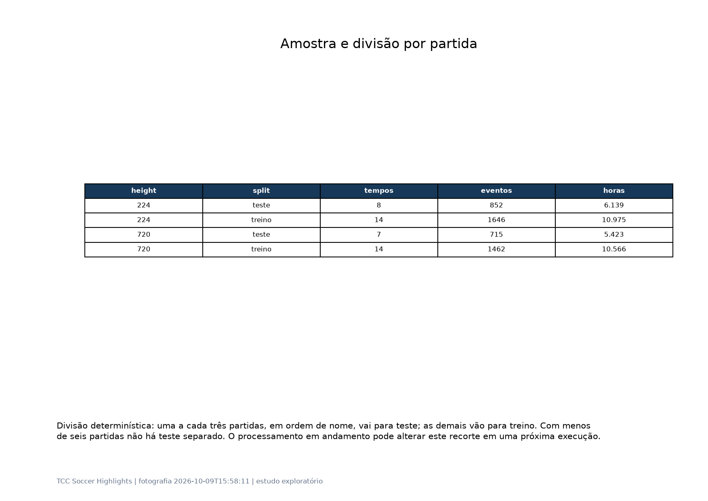

Divisão determinística: uma a cada três partidas, em ordem de nome, vai para teste; as demais vão para treino. Com menos de seis partidas não há teste separado. O processamento em andamento pode alterar este recorte em uma próxima execução.

## Identificação das partidas

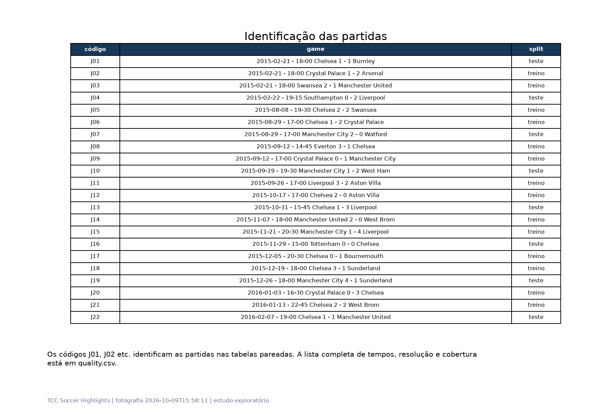

Os códigos J01, J02 etc. identificam as partidas nas tabelas pareadas. A lista completa de tempos, resolução e cobertura está em quality.csv.

## Comportamento por tipo de evento

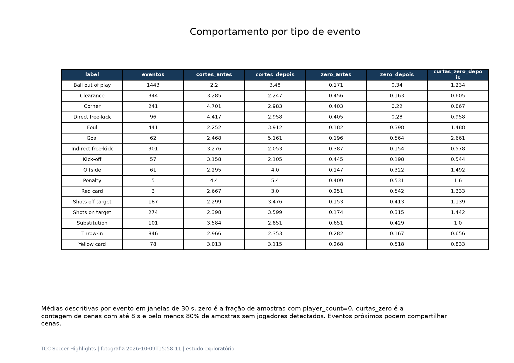

Médias descritivas por evento em janelas de 30 s. zero é a fração de amostras com player_count=0. curtas_zero é a contagem de cenas com até 8 s e pelo menos 80% de amostras sem jogadores detectados. Eventos próximos podem compartilhar cenas.

## Contrastes e incerteza por partida

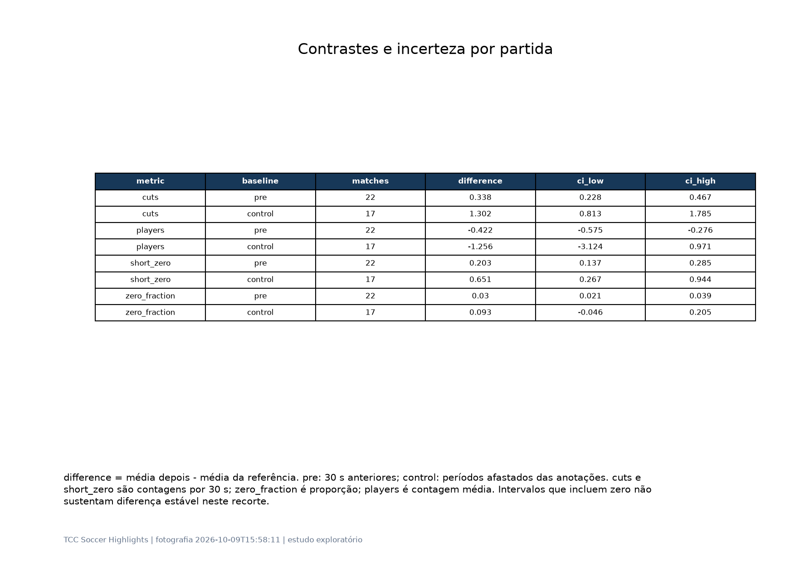

difference = média depois - média da referência. pre: 30 s anteriores; control: períodos afastados das anotações. cuts e short_zero são contagens por 30 s; zero_fraction é proporção; players é contagem média. Intervalos que incluem zero não sustentam diferença estável neste recorte.

## O que os dados sustentam

cortes por 30 s: diferença 1.302, IC95% [0.813, 1.785]; aumento com intervalo acima de zero, em 17 partidas com controle.

média de jogadores detectados: diferença -1.256, IC95% [-3.124, 0.971]; diferença com intervalo incluindo zero, em 17 partidas com controle.

cenas curtas com baixa detecção por 30 s: diferença 0.651, IC95% [0.267, 0.944]; aumento com intervalo acima de zero, em 17 partidas com controle.

fração de zero detecções: diferença 0.093, IC95% [-0.046, 0.205]; diferença com intervalo incluindo zero, em 17 partidas com controle.

A afirmação “sempre depois de um evento” deve ser substituída pelas taxas medidas por classe. A ausência do padrão não é evidência de ausência de um melhor momento. Saídas de bola, faltas e substituições também podem causar closes e cortes.

Segundo a observação do grupo, o YOLO foi treinado para a câmera aberta padrão e deixa de detectar jogadores em closes e replays de outros ângulos. Assim, zero jogadores é uma pista de mudança de domínio visual. Não distingue automaticamente replay, torcida, close, placar ou baixa resolução; precisa de inspeção humana.

## Perfil temporal ao redor dos eventos

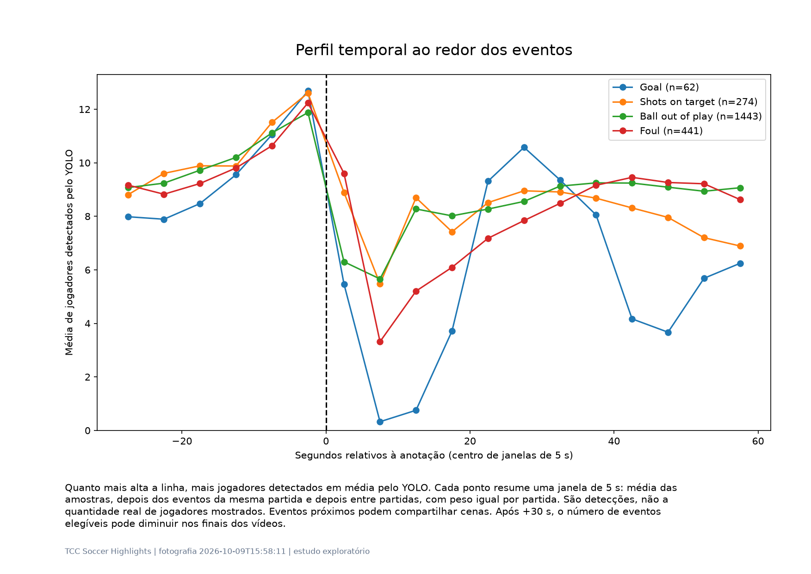

Quanto mais alta a linha, mais jogadores detectados em média pelo YOLO. Cada ponto resume uma janela de 5 s: média das amostras, depois dos eventos da mesma partida e depois entre partidas, com peso igual por partida. São detecções, não a quantidade real de jogadores mostrados. Eventos próximos podem compartilhar cenas. Após +30 s, o número de eventos elegíveis pode diminuir nos finais dos vídeos.

## Sensibilidade à resolução

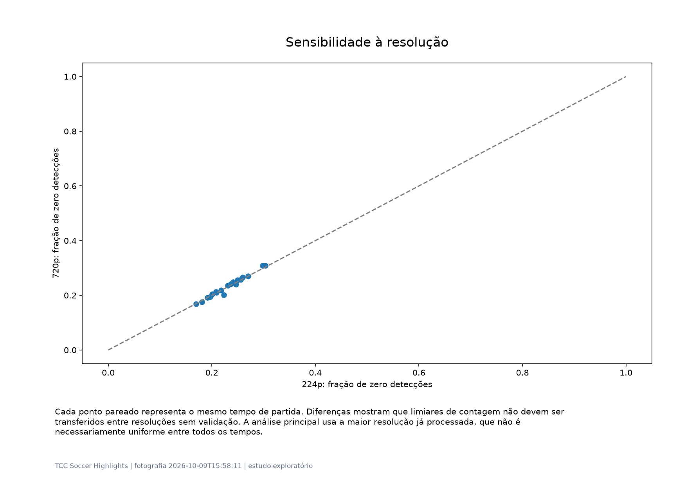

Cada ponto pareado representa o mesmo tempo de partida. Diferenças mostram que limiares de contagem não devem ser transferidos entre resoluções sem validação. A análise principal usa a maior resolução já processada, que não é necessariamente uniforme entre todos os tempos.

## 224p versus 720p: mesmo conteúdo e timestamp

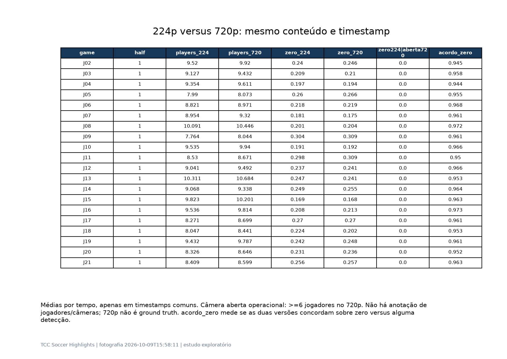

Médias por tempo, apenas em timestamps comuns. Câmera aberta operacional: >=6 jogadores no 720p. Não há anotação de jogadores/câmeras; 720p não é ground truth. acordo_zero mede se as duas versões concordam sobre zero versus alguma detecção.

## Ganho de contagem na resolução maior

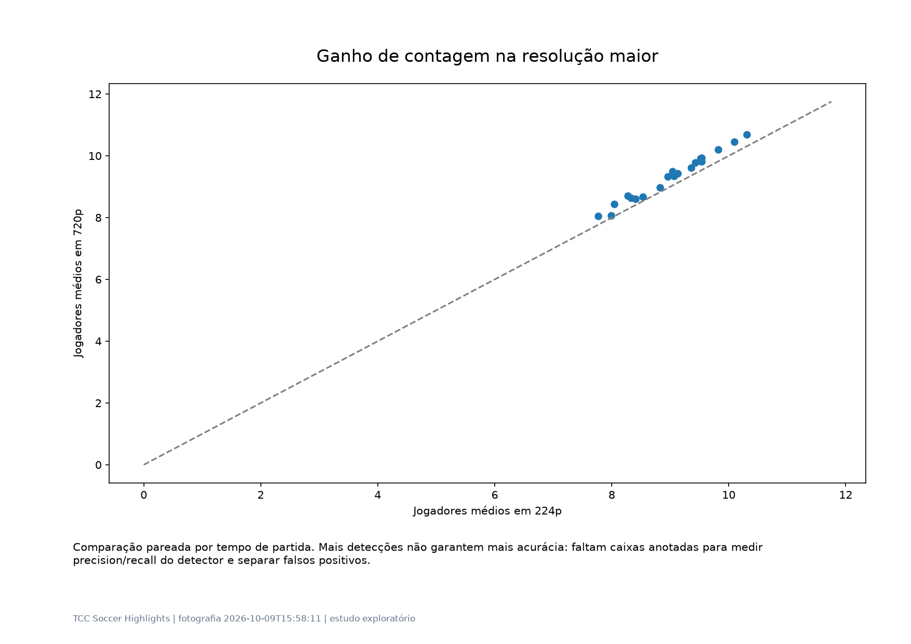

Comparação pareada por tempo de partida. Mais detecções não garantem mais acurácia: faltam caixas anotadas para medir precision/recall do detector e separar falsos positivos.

## A mesma regra em ambas as resoluções

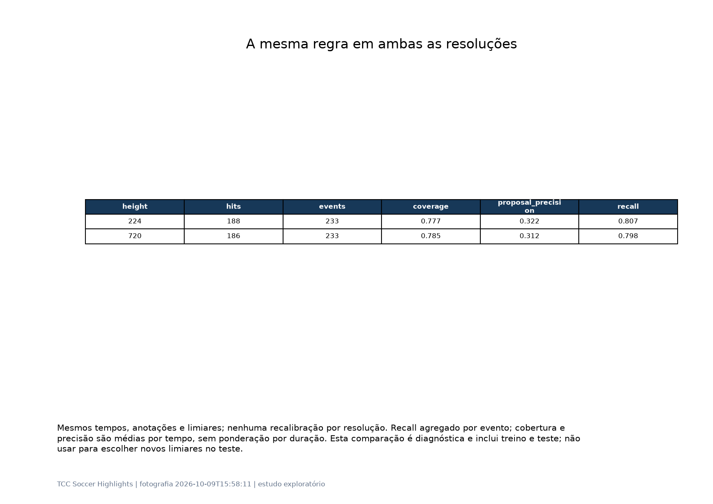

Mesmos tempos, anotações e limiares; nenhuma recalibração por resolução. Recall agregado por evento; cobertura e precisão são médias por tempo, sem ponderação por duração. Esta comparação é diagnóstica e inclui treino e teste; não usar para escolher novos limiares no teste.

## Vale a pena usar 720p?

Comparação com 20 tempos pareados de 20 partidas. Média por partida: jogadores 224p=9.00, 720p=9.31; fração de zeros 224p=23.2%, 720p=23.3%. Diferença 720p-224p em zeros=0.001, IC95% [-0.002, 0.004].

Quando 720p detecta pelo menos seis jogadores, 224p produz zero em média em 0.0% dos timestamps. Esse é um indicador operacional de zeros possivelmente causados pela qualidade, não uma taxa de erro comprovada.

O processamento completo do pipeline em 720p levou mediana de 3.20 vezes o tempo de 224p; o arquivo ocupou 5.16 vezes o tamanho. Os tempos incluem leitura, YOLO, TransNet e escrita de Excel: não isolam o custo de inferência nem controlam temperatura/GPU/processos concorrentes.

No TransNet, houve em média 239.7 cortes por tempo em 224p e 239.4 em 720p. Em média, 99.86% dos cortes 224p têm ao menos um corte 720p a até 0,5 s. É concordância entre versões, não precisão contra cortes anotados; não exige correspondência um a um.

No código local, o TransNet recebe frames RGB redimensionados para 48×27. O YOLO usa LetterBox e tamanho de inferência definido por imgsz (padrão instalado 640); model.predict não fixa imgsz no pipeline. O peso pode sobrescrever o padrão. Portanto, o YOLO também redimensiona: 720p preserva mais informação antes desse passo, mas não significa processar todos os pixels originais.

Com a mesma regra, 224p recuperou 188/233 eventos-alvo e 720p recuperou 186/233. Neste recorte, o ganho de contagem em 720p não trouxe ganho de recall para o filtro. Manter 224p é uma escolha inicial mais econômica para este objetivo; fixar resolução, imgsz e confiança na calibração.

Isso não valida 224p para detectar a bola, identidade dos jogadores ou detalhes da jogada: essas tarefas não foram avaliadas. Se a LLM precisar de detalhes, recuperar frames em maior resolução somente dos trechos selecionados. A comparação inclui apenas os tempos em que ambas as versões já terminaram.

Uma arquitetura candidata é TransNet no vídeo reduzido e YOLO em frames 720p somente nas cenas relevantes. Validar esse novo desenho em conjunto separado, pois a medição atual executou o pipeline inteiro. Replays em outros ângulos continuarão fora do domínio mesmo em 720p.

## Definição de melhores momentos e métricas

Eventos-alvo operacionais neste estudo: Goal, Shots on target, Shots off target, Penalty, Red card, Yellow->red card. É uma definição inicial para gols, finalizações, pênaltis e expulsões. Faltas, amarelos e escanteios podem ser adicionados pelo grupo; não são automaticamente melhores momentos.

Recall de eventos = anotações-alvo cujo instante está dentro de algum intervalo selecionado / total de anotações-alvo. Estar dentro do intervalo não garante que toda a jogada esteja visível ou que a LLM consiga classificá-la.

Cobertura = duração da união dos intervalos / duração coberta pelo YOLO. Redução de contexto temporal = 1 - cobertura. A precisão de propostas mede a fração dos intervalos unidos contendo ao menos um evento-alvo. Não é precisão por frame nem mAP de action spotting.

A economia monetária não foi medida: depende do modelo, frames enviados, resolução, áudio e tokens. Com amostragem uniforme, a duração é um proxy inicial de frames; deduplicação e orçamento de envio devem ser avaliados separadamente.

## Filtro: treino e teste sem vazamento de partidas

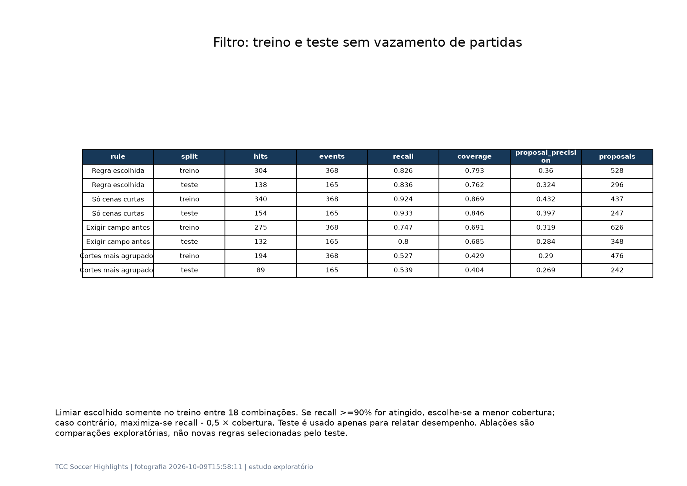

Limiar escolhido somente no treino entre 18 combinações. Se recall >=90% for atingido, escolhe-se a menor cobertura; caso contrário, maximiza-se recall - 0,5 × cobertura. Teste é usado apenas para relatar desempenho. Ablações são comparações exploratórias, não novas regras selecionadas pelo teste.

## Regra candidata para a solução final

1. Extrair cenas do TransNetV2 e calcular fração de player_count=0 usando somente amostras YOLO válidas. Disparar em cenas com duração <= 12 s, pelo menos três amostras e fração de zeros >= 50%.

2. Exigir pelo menos 1 cena(s) qualificadas em ±10 s do início da cena candidata. O próprio início conta. É uma regra offline com atraso de até 10 s para confirmar agrupamento.

3. Para cada início qualificado a, propor [a-20, a+25] s, limitar ao vídeo e unir intervalos sobrepostos. A janela anterior preserva a ação que pode ter causado o close posterior. A regra não conhece a anotação do evento.

4. Exportar início, fim e evidências. Dividir propostas longas em blocos de até 90 s com 5 s de sobreposição para preservar contexto entre blocos; isso aumenta levemente a duração enviada e não foi incluído na cobertura medida.

5. Enviar à LLM uma seleção de frames da ação anterior, da mudança visual e do contexto posterior. Solicitar tipo de evento, relevância e justificativa visual. Fixar orçamento de frames por trecho e medir perdas antes de descartar material.

treino: recall 82.6% (304/368), cobertura 79.3%, redução temporal 20.7%, precisão de propostas 36.0% (528 propostas).

teste: recall 83.6% (138/165), cobertura 76.2%, redução temporal 23.8%, precisão de propostas 32.4% (296 propostas).

## Como escolher o compromisso para produção

A regra candidata representa o melhor compromisso da busca que exige o sinal YOLO. Se nenhuma configuração atinge 90% de recall no treino, a seleção usa uma função exploratória que troca recuperação por cobertura; isso não estabelece um nível aceitável de perdas para o TCC.

Compare a ablação “Só cenas curtas”: se recuperar mais eventos com aumento pequeno de cobertura, a contagem YOLO deve funcionar como prioridade de envio, em vez de exclusão obrigatória. Assim o grupo pode preservar propostas sem queda de detecção para uma segunda fila.

Agrupamento mais exigente reduz a duração selecionada, mas pode perder jogadas isoladas. Não recomendar essa opção como filtro exclusivo sem aceitar explicitamente o recall observado. Gols e expulsões raros exigem auditoria individual.

A proposta prática é uma fila prioritária de cenas curtas com mudança de domínio, seguida de uma fila de segurança de cenas curtas sem exigir zeros. Fixar o orçamento com dados de treino e medir separadamente recall, custo da LLM e qualidade dos clipes.

## Fluxo operacional sem anotações de eventos

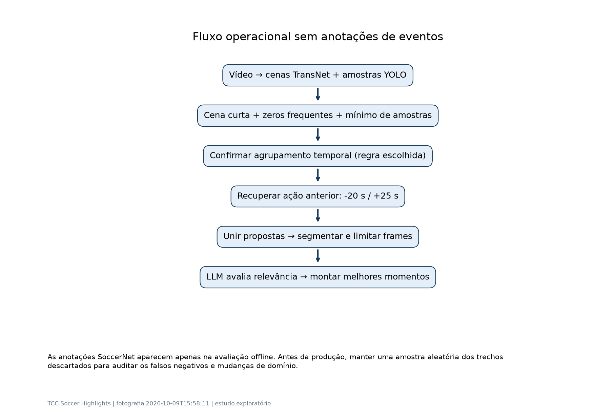

As anotações SoccerNet aparecem apenas na avaliação offline. Antes da produção, manter uma amostra aleatória dos trechos descartados para auditar os falsos negativos e mudanças de domínio.

## Recuperação por classe — treino

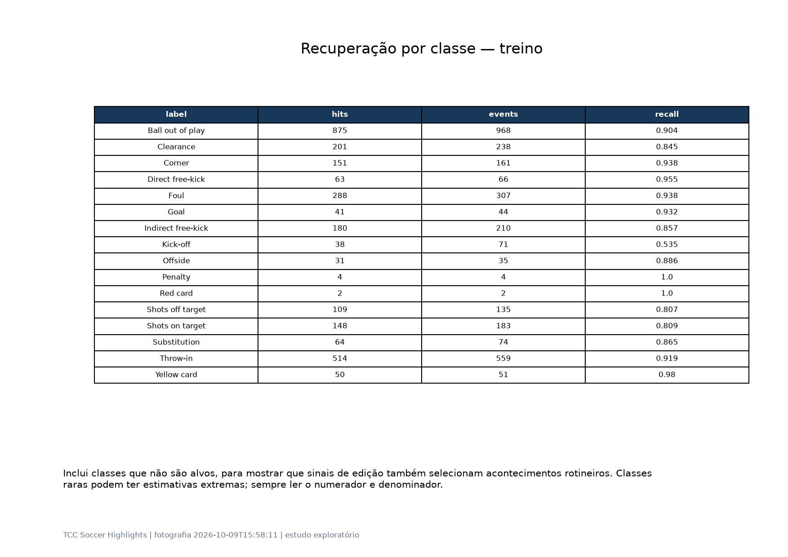

Inclui classes que não são alvos, para mostrar que sinais de edição também selecionam acontecimentos rotineiros. Classes raras podem ter estimativas extremas; sempre ler o numerador e denominador.

## Recuperação por classe — teste

Inclui classes que não são alvos, para mostrar que sinais de edição também selecionam acontecimentos rotineiros. Classes raras podem ter estimativas extremas; sempre ler o numerador e denominador.

## Compromisso entre custo e recuperação

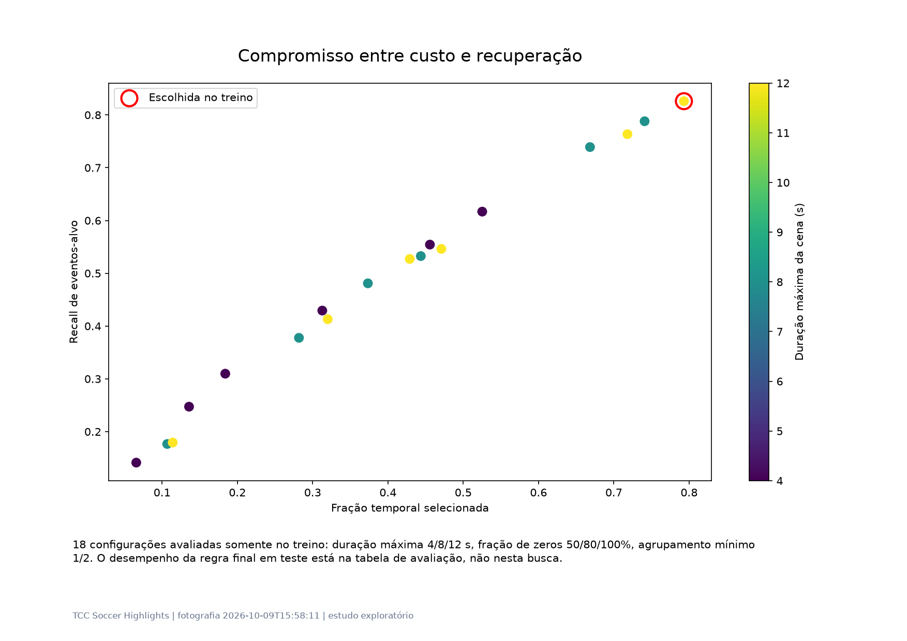

18 configurações avaliadas somente no treino: duração máxima 4/8/12 s, fração de zeros 50/80/100%, agrupamento mínimo 1/2. O desempenho da regra final em teste está na tabela de avaliação, não nesta busca.

## Limitações e próximos experimentos

Amostra parcial e de conveniência: foram analisados os arquivos completos disponíveis, na ordem do processamento. Resultados não representam todo o dataset ou todas as ligas. Não interrompemos nem reprocessamos os vídeos em execução.

As anotações incluem eventos visíveis e não exibidos. Avaliar ambos é conservador para seleção visual, mas convém reportar também uma avaliação restrita a visibility=visible. A precisão temporal das anotações e transições exige revisão de exemplos.

Os intervalos de confiança são exploratórios. Eventos-alvo raros e poucos jogos no teste limitam conclusões. O limiar escolhido é uma configuração candidata, não uma regra universal validada.

Inspecionar vídeos de verdadeiros positivos, propostas sem alvos e eventos perdidos. Auditar gols sem close, replays repetidos, começo/fim de tempo e vídeos 224p. Medir se a janela inclui a construção e o desfecho da jogada.

Quando mais partidas terminarem, repetir o estudo com divisão fixa por partida, validar por competição e resolução e depois reservar um conjunto final intocado. Medir classificação da LLM, custo real, recall e qualidade dos clipes completos.

Não descartar permanentemente uma cena longa ou com muitos jogadores: esse é justamente o plano em que a ação acontece. Os zeros e cortes servem para disparar recuperação do contexto anterior.

## Reprodução e arquivos para o grupo

Executar na raiz: .venv/Scripts/python.exe -m tcc_soccer_highlights.highlight_study. Os Excels existentes são lidos; não há inferência adicional de YOLO/TransNet nem chamadas externas.

snapshot.json registra data, arquivos e configuração. quality.csv contém a amostra; events.csv, lag.csv, paired.csv e effects.csv contêm resultados descritivos; grid.csv registra a seleção no treino; evaluation.csv e ablations.csv contêm a avaliação.

clips.csv contém candidatos para integração: video_id, game, split, start_sec, end_sec, duration_sec, reason. Esses trechos ainda precisam da avaliação semântica da LLM. Nenhum vídeo foi cortado automaticamente.

No Streamlit, as páginas “Eventos, cortes e YOLO”, “Simulador de regras” e “Relatório do estudo” permitem explorar os dados e baixar artefatos. O relatório é uma fotografia; atualizar o painel não atualiza automaticamente o PDF.